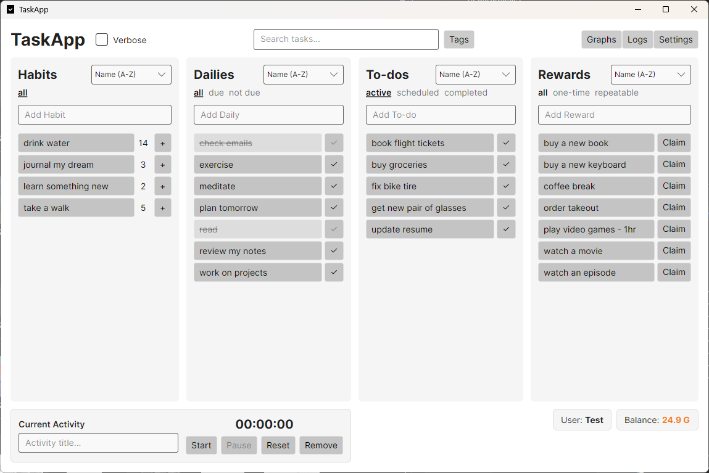
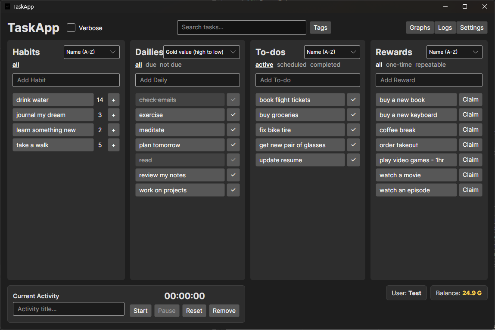
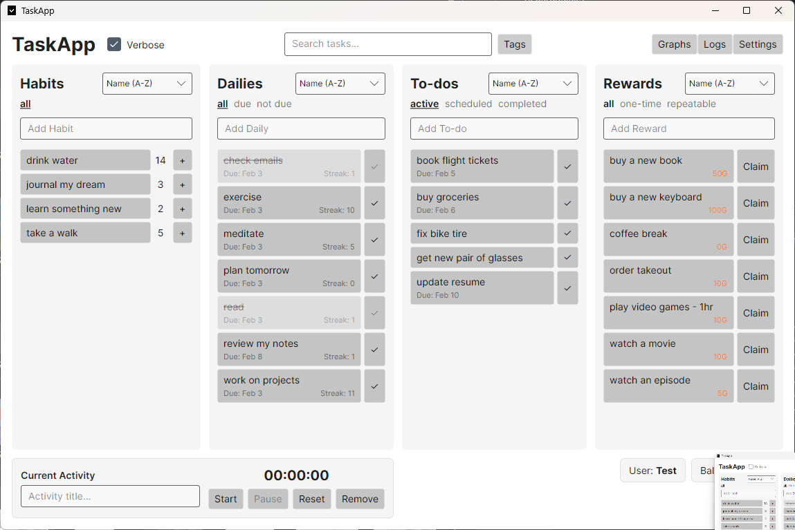
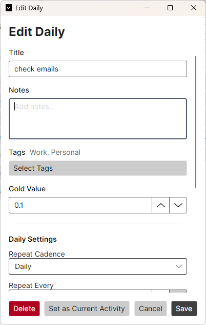
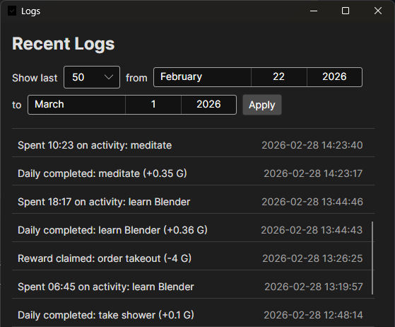
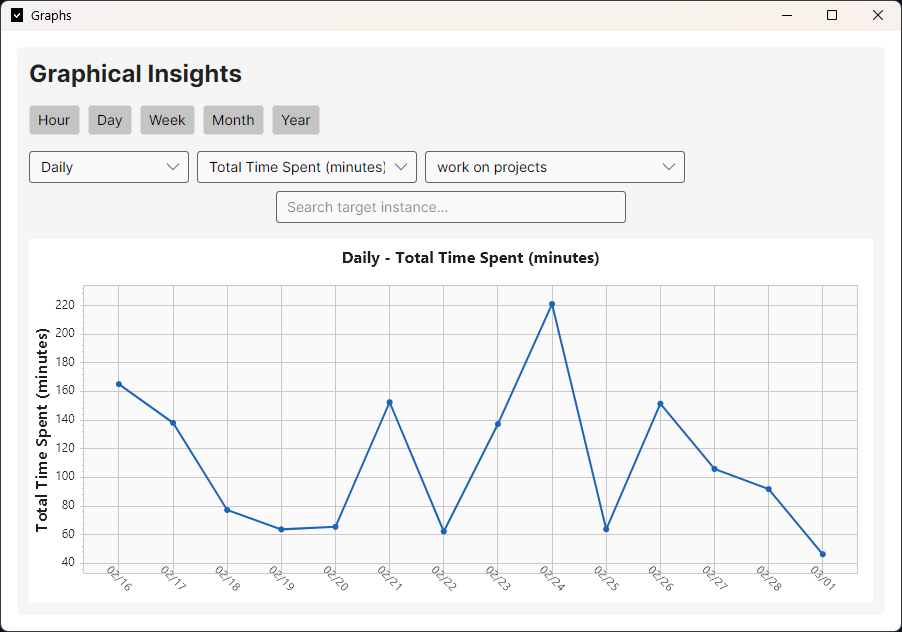
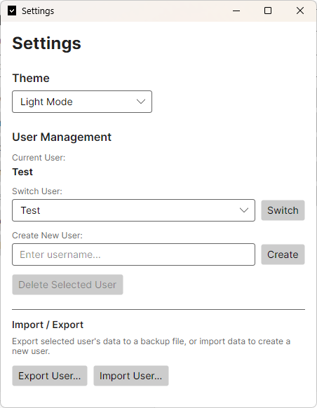

# TaskApp

A gamified task manager built with **Avalonia UI** and **.NET 10**. Track habits, dailies, and todos, earn gold, and spend it on your own rewards. Use the desktop app on its own or share profiles with the Android app through the optional Cloud API.


## Features

### 📋 Task Management
- **Habits** – Repeatable actions with increment/decrement counters and automatic resets (daily, weekly, monthly)
- **Dailies** – Recurring tasks with streak tracking, customizable schedules (daily, weekly, monthly, yearly), and optional time-based autocomplete
- **Todos** – One-time tasks with optional due dates and checklists. Titles turn amber within three days of a deadline and red once overdue.
- **Hide/Unhide** – Archive and restore tasks or rewards without deleting them
- **Sorting** – Per-category sort modes (name, created date, gold, streak, due date, etc.) that persist across sessions
- **Filtering** – Filter tabs for each task type (e.g. active, scheduled, or completed todos)
- **Auto-Resorting** – Columns re-sort automatically when task properties change
- **Context Menus** – Right-click tasks and rewards for quick actions

### 🏆 Gamification
- **Gold System** – Earn gold by completing tasks, spend it on custom rewards
- **Streak Bonuses** – Earn bonus gold for maintaining daily streaks (configurable milestones)
- **Streak Protection** – Protect daily streaks by paying a configurable gold cost per missed period instead of losing the streak
- **Vacation Mode** – Toggle vacation mode to automatically protect all daily streaks at no gold cost during absences
- **Rewards Shop** – Create one-time or repeatable rewards. Claimed one-time rewards dim, and undoing a claim makes the reward available again.

### ⏱️ Current Activity Timer
- **Time Tracking** – Set any task as your current activity and track time spent on it
- **Pause/Resume** – Pause the timer and resume with a single button
- **Daily Autocomplete** – Dailies can auto-complete when a configurable time threshold is reached
- **Time This Period** – Dailies show their accumulated logged time for the active repeat period, even without an autocomplete threshold.

### 📊 Analytics & Insights
- **Graphs** – Visualize productivity over time (hourly, daily, weekly, monthly, yearly views)
- **Activity Logs** – Track all task completions and reward claims with timestamps, gold changes, and activity durations
- **Log Filtering** – Filter logs by date range and limit count
- **New Day Detection** – Review missed visible dailies and protect streaks across multi-day gaps.
- **Undo System** – Undo any logged action from the Logs window with full state reversal including streak protection rollback

### 🎨 Customization
- **Themes** – Open the Settings gear and choose **General → Theme** for Light, Dark, Forest, or Follow System. Forest uses green surfaces, teal accents, and a matching native frame on Windows 11.
- **Compact Scrollbars** – Desktop windows use slim scrollbars that reserve space beside the content.
- **Multiple Users** – Support for multiple user profiles with separate data
- **Tags** – Organize tasks with custom tags
- **Verbose Mode** – Toggle detailed information including due dates and streak details

### 💾 Data Management
- **Export/Import** – Backup and restore user data as `.taskapp` ZIP archives
- **Per-User Data Storage** – Each user has isolated data (tasks, rewards, tags, logs)
- **UTC-Aware Timestamps** – All timestamps use `DateTimeOffset` for correct display across time zones
- **Cloud Profiles** – Open **Settings → Cloud Sync** to upload or download full profile snapshots. Use the Android profile picker to open a profile and work through its tasks and rewards.

## Screenshots

These screenshots show earlier desktop builds. See the [feature guide](docs/features.md) for current navigation.

### Main Window


### Dark Mode


### Main Window (Verbose Mode)


### Edit Task Form


### Logs Window


### Graphs & Analytics


### Settings


## Getting Started

### Prerequisites
- [.NET 10 SDK](https://dotnet.microsoft.com/download/dotnet/10.0)

### Build From Source & Run

```bash
# Clone the repository
git clone https://github.com/hyi96/TaskApp.git
cd TaskApp

# Run the desktop application on Windows
dotnet run --project TaskApp/TaskApp.csproj -f net10.0-windows10.0.19041.0
```

On macOS and Linux, run the same project with `-f net10.0`.

### Release Builds

On Windows, run this PowerShell command for desktop release packages:

```powershell
.\build-all.ps1 -Configuration Release -SkipAndroid
```

The Windows x64 executable is at `dist/Windows/win-x64/TaskApp.exe`, with a matching ZIP in `dist/Windows/`. The script replaces `dist` on each run. Close apps launched from that folder first. For Android prerequisites and the signed APK location, see the [Android guide](docs/android-apk.md).

### Running Tests

The test project targets .NET 10 and uses xUnit with Avalonia headless testing.

```bash
dotnet test TaskApp.Tests/TaskApp.Tests.csproj
```

## Project Structure

See the [documentation index](docs/README.md) and [architecture guide](docs/architecture.md) for the full layout.

```text
TaskApp.Core/               # Shared domain, DTOs, mappers, and service contracts
TaskApp.Api/                # ASP.NET Core API for account and profile snapshots
TaskApp.Android/            # Native Android app
TaskApp/                    # Avalonia desktop app and local infrastructure
TaskApp.Tests/              # xUnit test project (.NET 10)
docs/                       # Architecture, service, storage, and cloud foundation docs
```

## Cloud Sync and Android

Start in **Settings → Cloud Sync** on desktop. Create or verify a cloud account, then upload the profiles you want on your phone. Sign in to Android with the same API URL, account ID, and account secret. Select a profile from the picker to load it.

Sync replaces whole profile snapshots. Upload your changes from one device and download the latest snapshot on the other before editing there. See the [cloud workflow](docs/cloud-api.md) and [VPS deployment guide](deploy/vps/README.md).

## Technology Stack

| Component | Technology |
|-----------|------------|
| Shared Core | TaskApp.Core (.NET 10 class library) |
| UI Framework | [Avalonia UI 11.3.9](https://avaloniaui.net/) |
| Runtime | .NET 10 |
| Database | SQLite (Microsoft.Data.Sqlite) |
| Charts | [ScottPlot 5](https://scottplot.net/) |
| Architecture | MVVM |
| Testing | xUnit 2.9.3 + Avalonia.Headless.XUnit (.NET 10) |

## Usage Tips

- **Quick Add**: Type a task name and press `Enter` to quickly add it
- **Edit Tasks**: Click on any task to open the edit form with full options
- **Context Menus**: Right-click tasks or rewards for quick actions (set as current activity, hide/unhide, etc.)
- **Current Activity**: Set a task as your current activity to track time spent on it
- **Search**: Use the search bar to filter tasks across all categories
- **Verbose Mode**: Toggle the **Verbose** checkbox to show details such as due dates and streaks
- **New Day Detection**: The app automatically detects day changes, resets daily tasks, and resets habit counters based on cadence
- **Streak Protection**: When the new day window appears, toggle "Protect" to pay gold and keep a daily's streak instead of losing it
- **Vacation Mode**: Enable vacation mode to automatically protect all daily streaks at no gold cost while you're away
- **Hide/Unhide**: Archive tasks or rewards you don't need right now and restore them later
- **Sort Preferences**: Each task category has its own sort mode that persists between sessions
- **Log Filtering**: Use the date range picker and limit options in the Logs window to narrow down entries
- **Export/Import**: Back up your data via Settings — the `.taskapp` file is portable across time zones

## Inspirations

This project was inspired by [Habitica](https://habitica.com/), a gamified task management platform that transforms productivity into an RPG adventure.

## License

TaskApp is licensed under the [MIT License](LICENSE). See [third-party notices](TaskApp/ThirdPartyNotices.txt) for the Settings icon.

## Contributing

Contributions are welcome! Feel free to open issues or submit pull requests.
